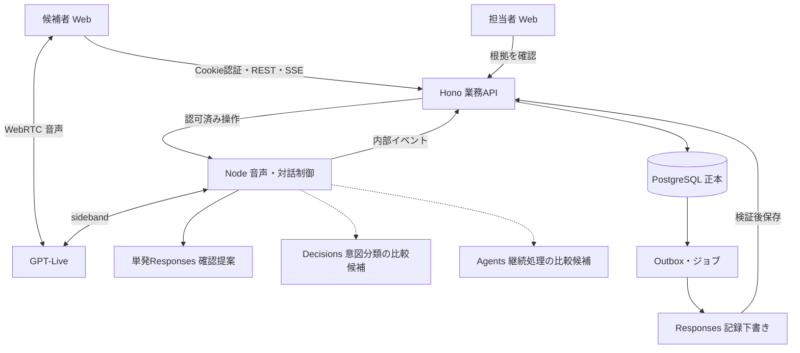
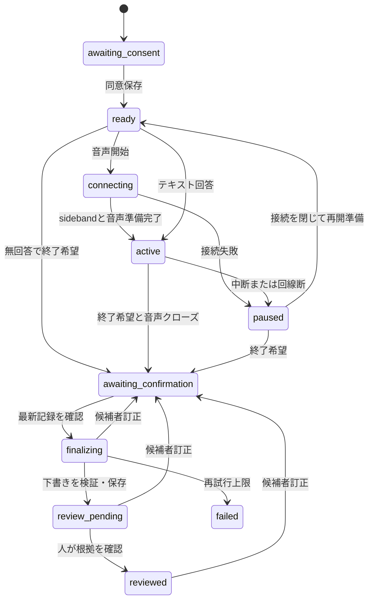

# 構成とデータの正本

ステータス：新提案 v0.3。公開HTTP契約はv0.2を維持。対象は職務に関係する情報の収集と構造化。モデルが採用可否を決める処理は置かない。

| 層 | 責任 | 持たせない権限 |
|---|---|---|
| React/TS/Vite | 同意、マイク、字幕、訂正、停止、確認、SSE再接続 | OpenAIキー、企業IDの自己申告による認可、確定状態の直接更新 |
| Hono/Workers | Cookie認証、テナント・担当割当、同意、業務状態、DBトランザクション、冪等性、outbox | 音声WebSocketを短命リクエストだけで維持する責任 |
| Node長期稼働サービス | Live作成/sideband、転記、固定進行、必要時の単発推論、モデル世代の照合 | クライアント申告の権限、任意SQL、外部通知、採否決定 |
| PostgreSQL/Supabase案 | 正式な状態・記録・ACL・監査・キューoutbox | ブラウザーからのservice_roleアクセス |
| ジョブワーカー | 下書き生成、削除、期限切れ処理、再試行 | 世代不一致の結果を上書きすること |

NodeとWorkersを分ける構成は既存Web案に合わせる。配置地域、キュー実装、Supabaseの正式採用は未決。初期モックでは同一プロセスでもよいが、契約・認可境界を維持する。

## 接続と対話の一巡

1. 担当者が職務情報と質問テンプレートの不変バージョンを作る。招待作成時にそのバージョンを固定する。
2. 招待トークンを一度だけ交換し、候補者を当該面談だけに限定したアプリセッションにする。本人確認を済ませたとは表示しない。
3. 候補者にサーバー生成の同意文書を提示し、同意保存後に初めてマイクを要求する。AI利用・文字記録・目的・保存・処理先・中止方法を説明する。
4. WebRTCのofferを業務APIへ送る。NodeがサーバーキーでLiveを作り、sideband購読を確立してからSDP answerを返す。マイクtrackは無効状態で用意し、`voice.ready`まで送信しない。
5. Nodeは入力・出力の文字断片を受信時に永続化する。ブラウザー字幕はSSEの正本を使用し、DataChannelから同じ文字を二重登録しない。
6. 意味のまとまりごとにアプリが仮の発話を作る。必要な対応は委譲された単発Responsesで提案する。Decisionsを有効にする場合は「続行/訂正/一時停止/終了希望/同意撤回希望/人に相談/不明」だけを分類する。分類失敗は確認質問に落とす。同意撤回希望を検知したら音声を一旦停止して画面で確認し、そのまま面談を続けない。停止ボタンは分類を経由せず即時に作用する。
7. 単純な次質問はアプリが決める。文脈確認が必要な場合は単発Responsesでnext-step提案を得る。アプリが許可済み質問、順番、発話バージョン、同意を検証してLiveへ伝える。Agentsは継続的な複数ツール作業が必要な場合の比較候補とする。Liveへの一問ずつの発話指示だけで出力が保証されるとは扱わない。
8. 終了希望では録音送信を停止し、backendの新規タスクを止め、`session.close`から`session.closed`までイベントを取り込む。その後に候補者へ最新の文字記録と未確認箇所を提示する。
9. 候補者が文字記録のバージョンを確認して`finish`する。トランザクションでsnapshotとoutboxを保存し、非同期でレポート下書きを作る。
10. 担当者が根拠・訂正・不足を確認する。確認済み記録として保存するが、採否の自動決定・通知は行わない。

## 状態とバージョン

同意撤回・明示的取消はどの未削除状態からも`cancelled`にする。`failed`からの再生成は同じ確認済みsnapshotに対する運用操作であり、面談や招待を増やさない。再開は接続IDを変え、面談IDを維持する。テキスト回答は音声接続なしでも`active`に進める。

`awaiting_confirmation`は終了要求の受領から使う。音声接続をclose/drainしている間は最終確認を無効にし、active_connection_idがnullになるまでfinishを許可しない。過去のgapは接続を跨いで保持し、人の欠落確認を最新のtranscript_versionに紐付ける。状態名だけで終了可能と判定しない。

- `revision`：状態、同意、訂正、確定などの業務更新の楽観ロック。字幕断片ごとには増やさない。
- `transcript_version`：正規化した発話の追加・訂正・後着の反映で増える。候補者の最終確認はこの値に結びつく。
- `generation`：モデルへ渡す文脈の世代。訂正、取消、再開、質問計画更新で増える。旧世代の結果を捨てる。
- `seq`：面談内の永続イベント通番。SSE再送の順序であり発話時刻の順序ではない。
- `report_version`：同一面談の下書きバージョン。元のtranscript_version・prompt_version・modelを固定して持つ。

## 文字起こしの正確な扱い

Liveの`session.input_transcript.delta`と`session.output_transcript.delta`には文字断片と`start_ms/end_ms`があるが、発話確定イベントや文字起こし精度の保証はない。入力と出力は重なる。空白や繰り返しを勝手に除去せず、`(provider_session_id,event_id)`で重複排除する。時刻は各接続の相対値であり、再接続後の0msと前の接続の0msを混同しない。

アプリ独自の`utterance_id`を生成し、話者・接続・タイムスタンプ・対応する原断片IDを保存する。区切りは暫定扱いであり、無音の推定だけで同意・回答確定・終了を成立させない。後着断片がsnapshotを変えたら、確認を無効にして再確認する。`session.closed`が来ずに回線が切れた場合は`finalization_confirmed:false`と記録し、再接続または担当者の欠落確認を求める。欠落を隠して正常終了させない。

音声原本は初期案では保存しない。従って後日の録音再生でASRを照合できないという制約をUIと運用に明示する。候補者による文字の確認・訂正と、担当者による追加確認で補う。別途録音を導入する場合は独立した同意・期限・アクセス設計を再レビューする。

## 訂正と中断

訂正は`utterance_id`と対象の`utterance_revision`、置換テキストを指定する。音声での訂正希望はまず確認表示し、確定操作を要求する。アプリはDB内で訂正履歴を追加し、正規テキストを差し替え、transcript_versionとgenerationを進める。元の発話は制限付き監査として保持し、通常の要約入力には訂正後だけを使う。

訂正時は旧backend処理を取り消し（Agents使用時はターンcancel）、進行中ジョブをstale扱いにする。cancelはロールバックではないため、完了コールバックにも世代チェックを入れる。UIは再生を一時停止し、サーバーは`session.input_audio.mute`のackを確認する。muteは候補者入力だけに作用し、出力再生やAgentsを止めない。Liveへ訂正事実を渡すだけで再生を再開しない。出力音声の待機分を破棄し、正本・旧ジョブ失効・有効な次の発話を照合する。旧音声や文脈を安全に分離できなければLiveを閉じ、正規テキストから新規接続する。すでに聞こえた内容は撤回できないため口頭でも訂正を伝える。

短い停止でも音声課金は続く。初期案では30秒超の明示的pauseでLiveを閉じ、再開時は確認済みテキストをもとに新規接続する。思考中の無音を勝手に終了扱いしない。再開時の冒頭音声を失わないよう、接続準備完了まで「再開準備中」を表示する。

## 永続データと信頼境界

| テーブル群 | 最低限のキー・内容 |
|---|---|
| tenants / memberships / assignments | tenant_id、subject_id、role、面談への担当割当、失効日時 |
| template_versions | tenant_id、version_id、職務記述、承認済み質問と必須項目、作成者、hash。不変 |
| interviews / invitations | tenant_id、interview_id、template_version_id、候補者subject、状態、各version、token_hash/有効期限/使用日時 |
| consent_receipts | policy_id/version/hash、対象面談、明示操作、server日時、撤回日時、表示locale |
| voice_connections / raw_fragments | opaque provider ID、接続世代、相対時刻、event_id、最終化状態。断片には企業と面談キー |
| utterances / corrections | 原断片参照、話者、質問ID、正規テキスト、revision、訂正元/理由/actor |
| reports / reviews | schema_version、根拠参照、元transcript_version、prompt/modelバージョン、人のreview結果 |
| operations / outbox / audit / deletion_jobs | 冪等キーhash、payload hash、処理結果、世代、期限、最小限の監査、削除進捗 |

全テーブルの関連キーにtenant_idを含め、別企業のIDとの結合をDB制約でも防ぐ。Node→業務APIはサービス認証＋短命署名（audience、interview_id、generation、expiry、nonce、本文hash）を検証する。署名の有効期限は提案60秒、nonceを再使用不可とし、ブラウザーに署名鍵を渡さない。受信イベントのtenant_idは接続のサーバー側レコードから解決する。

ジョブは`(interview_id,transcript_version,prompt_version,job_type)`を一意化する。DB更新とoutbox登録を同じトランザクションで行い、ワーカーは重複配信を前提に処理する。プロバイダーへの不明な送信結果は、成功か失敗かを照合してから再送する。上流streamには自動的な完全リプレイがあると仮定しない。

基準構成の変更理由と内部next-step契約、再生制御の限界は[公式ガイドとの照合](10-openai-guidance-review.md)を参照する。UI停止・同意・保存のアプリ責任と、音声品質の実測を分ける。
