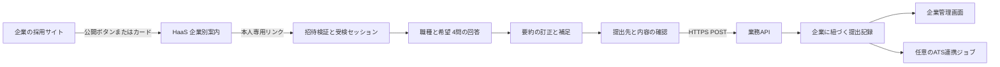

# 企業サイトから利用するHaaSの提供形態と構成案

HaaSを、複数の企業が共通の基盤を利用するホスト型サービスとして提供する。各社は採用サイトにボタンまたはカードのHTMLを設置し、候補者はHaaSの企業別案内ページへ移動する。個別の受検リンクで質問に回答し、要約を訂正して企業へ提出する。企業はHaaSの管理画面で受領した結果を確認する。

参照したい体験は、ユーザーがHireRooで経験した「外部の受検ページへ移動し、個別に受検して結果を渡す」流れ。HireRooの公式サイトは今回の環境の接続制限で取得できておらず、同サービスの現行仕様や内部構成を確認した記述ではない。

## 提供するもの

- 企業向け：契約企業のワークスペース、求人・質問設定、公開案内ページ、個別招待、提出結果の確認。
- 採用サイト向け：HaaSの公開案内ページへ移動するボタン／カードのHTML。初期版はスクリプト配布を不要にする。
- 候補者向け：通常のブラウザで開く受検ページ。企業名と対象求人を表示し、質問、要約、答え直し・補足、提出先確認、受領確認へ進む。

初期版はページ全体をHaaSに移して受検する。第三者サイト内で音声や認証を動かすiframe、JavaScript SDK、アプリのダウンロード、各社へのサーバーパッケージの納品は初期範囲に含めない。契約・課金単位は企業を基準に今後決める。従量枠、プラン、決済は未実装。

## 公開の入口と個別招待

| 種類                                                | 含む情報                       | 役割                                                                       |
| --------------------------------------------------- | ------------------------------ | -------------------------------------------------------------------------- |
| 公開案内 `/apply/:campaignId`                       | 公開可能な企業名、募集名、説明 | 採用サイトに貼る共有リンク。回答の閲覧権限を持たない                       |
| 個別招待 `/invite/:token`（本番案）                 | 推測困難な一時トークンのみ     | 特定の企業・求人・候補者・面談をサーバーで特定し、受検セッションへ交換する |
| 受検セッション `/candidate/:assessmentId`（本番案） | 公開しても認可にならないID     | Cookieとサーバー側の認可で、その候補者の面談だけを操作できる               |
| 管理ワークスペース（本番案）                        | 企業への所属・担当者権限       | 同じ企業の提出結果を確認する                                               |

公開カードに個別招待やAPIキーを埋め込まない。企業の管理画面から個別招待を発行する。公開ページから申し込みを受け付ける場合も、候補者の連絡先確認、利用制限、不正発行対策を通して個別招待を発行する。候補者識別の詳細は認証実装時に決める。

本番では招待をHTTPSのPOSTで交換し、期限・失効・利用済み状態を検証する。トークンはハッシュで保管し、交換後はURLから除去する。アクセスログ・解析・Referrerに残さない。失効・不明な招待は他企業のデモへフォールバックしない。

## 画面とデータの流れ

ReactとTypeScriptのFE、HonoとTypeScriptの業務API、Node.jsとTypeScriptの音声BE、PostgreSQLとRLSの基本案を維持する。最初はモノレポ内で画面と責務を分ける。本番では候補者用と企業管理用のホスト／配信を分離し、それぞれ同一オリジンのAPIを使う構成を第一候補とする。専用ビルドまたはサーバールートで配信を制限する。単に別ドメインから同じSPAを配信するだけでは管理画面の分離にならない。

## 提出と結果の受け渡し

本番の提出は、同意済み・回答済み・招待有効・企業との紐づきをAPIで検証して行う。ブラウザの完了遷移を受領の根拠にしない。回答、確認済み要約、補足、質問テンプレートの版、確認時刻を一つの提出版として永続化し、トランザクション成功時に受領番号を返す。

状態案は `invited → in_progress → ready_to_submit → submitted → processing → review_pending`。提出前の訂正は許可し、提出後の変更は別の訂正版として履歴を残す。AIの要約、人の確認、候補者による訂正を混同しない。採否は人が判断する。

提出APIは冪等キーと一意制約で重複を防ぐ。タイムアウト時は同じキーで状態確認・再送を行い、受領を確認できるまでは「提出済み」と表示しない。提出保存と通知用outboxを同じトランザクションにし、連携障害で受領済み回答を失わない。

企業への受け渡しはHaaSの企業管理画面を第一段階とする。ATSへのWebhookは後続実装。宛先を企業管理者が登録・確認し、公開HTTPS宛先だけを許可して、内部IP・メタデータ・リダイレクト先を含むSSRFを防ぐ。イベントID、送信時刻、署名と再送管理を用意する。Webhookには原則イベントIDと結果参照IDだけを含め、詳細は認可付きAPIで取得する。APIキー・署名鍵はサーバーのSecret管理に置く。候補者のURLパラメータから送信先を指定しない。

## 企業間の分離と通信

企業、所属、求人、公開案内、招待、受検、回答、提出版、レポート、連携宛先を別のモデルとし、すべての非公開データに企業の所有関係を持たせる。複合外部キー等で企業をまたぐ紐づけを防ぎ、APIの認可とRLSの両方で確認する。`companyId`、URLのID、ブラウザの選択状態を認可として扱わない。

- FE・API・外部連携はHTTPS強制、TLS 1.3優先・最低TLS 1.2。HSTSと証明書検証を配信環境で確認する。
- 受検セッションはHttpOnly・Secure・SameSite Cookie、CSRF対策、期限と失効を設ける。受検者にはその面談に必要な権限だけを付与する。
- iframeの許可は不要。`frame-ancestors 'none'` と `X-Frame-Options: DENY` を維持する。公開HTMLはリンクなので企業サイトのCSPへのスクリプト追加も不要。
- 戻り先は企業が登録しサーバーで検証したHTTPS URLの許可リストから選ぶ。`returnUrl` をそのまま遷移先にせず、回答や受領情報をクエリで企業サイトに返さない。
- 音声開始後はWebRTCのDTLS-SRTP、サービス間はHTTPS/WSS、DBはTLSと証明書検証。認証・同意・録音と保存の条件を整えてから接続する。

## リアルタイム文字起こしと本人による回答

音声入力中に途中・確定の文字起こしを区別して表示し、候補者が確認・訂正して回答を確定する。原文・訂正文・要約の版を分け、古い発話イベントや再送で上書きしない。現在は架空の回答を逐次表示するデモで、マイク・カメラ・実際の認識APIは使用しない。

カメラ必須化は未確定。初期案はAIによる一次ヒアリングでは任意とし、選考後半の短い有人確認で必要に応じて依頼する。カメラや視線だけでAIの代行を検出できるとは扱わない。常時映像解析を前提にせず、AI利用範囲の事前説明、直前の回答に沿った1〜2問の追加質問、根拠付き記録と人の確認を中心にする。視線・沈黙・回答速度から不正判定や自動不採用を行わない。

カメラを要求する場合は目的・録画の有無・保存と削除・代替手段を事前に説明する。詳細は [文字起こしと本人による回答の確認](interview-integrity.md) を参照。

## 今回の実装と本番との差

`features/delivery` に公開案内の架空設定、設置用HTML、採用サイトの設置例を追加した。`features/candidate` は招待IDごとに独立した一時状態を持つ。`demo` と `sora-demo` は2社の架空リンクであり、認証情報ではない。企業を切り替えたときに回答を引き継がず、不明なIDは専用エラーにする。

公開案内から個別リンクを取得する操作と、企業への提出は「現在利用できません」と表示する。API呼び出し、招待発行、提出保存、通知は行わない。「送信せず完了画面を確認する」は操作確認専用で、受領済みを意味しない。企業側の結果は独立した架空データを表示する。

設置用HTMLの `https://assessment.haas.example` はプレースホルダー。実際のドメインと配信環境は未設定。現在のSPAは管理画面も含むローカルプロトタイプで、企業間の認可や本番ホスト分離の実装ではない。認証を後から付ける方針に合わせ、個人情報を扱う公開運用は接続実装後とする。
